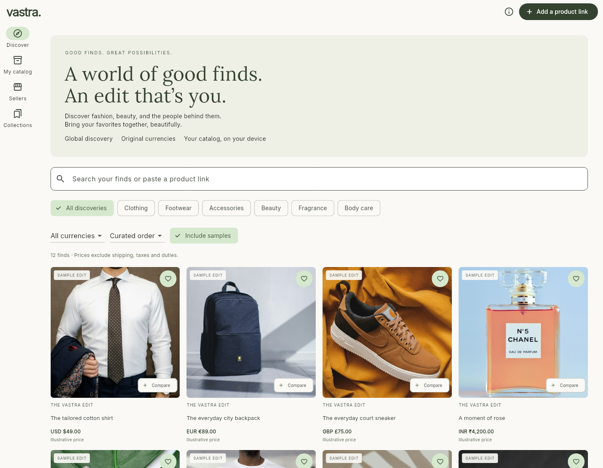
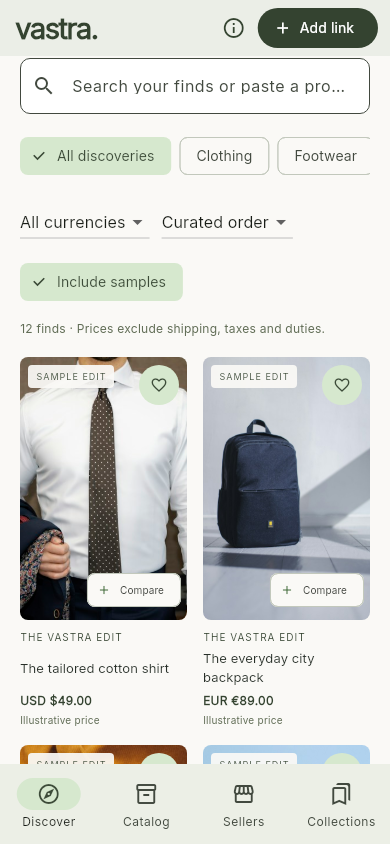
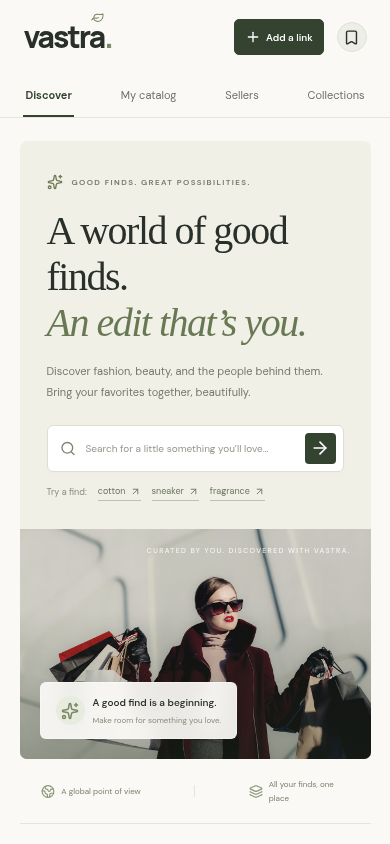

<h1 align="center">
  <br>
  <a href="https://github.com/sudharamachandranrajeev/vastra"></a>
  <br>
  Vastra
  <br>
</h1>

<h4 align="center">A considered way to discover fashion, beauty, and the people behind them — for Android, Windows and Linux.</h4>

<p align="center">
  <a href="https://github.com/sudharamachandranrajeev/vastra/releases"></a>
  
  
  
  <a href="https://github.com/sudharamachandranrajeev/vastra/actions/workflows/native.yml"></a>
</p>

<p align="center">
  <a href="#key-features">Key Features</a> •
  <a href="#screenshots">Screenshots</a> •
  <a href="#how-to-use">How To Use</a> •
  <a href="#download">Download</a> •
  <a href="#current-scope">Current Scope</a> •
  <a href="#credits">Credits</a> •
  <a href="#related">Related</a> •
  <a href="#license">License</a>
</p>

<p align="center">
  
</p>

Vastra brings clothing, footwear, accessories, cosmetics, fragrances, and personal care into
one personal edit. **Standalone, with no account required:** the native apps keep your catalog
and collections on your device in SQLite. Vastra does not depend on Brahma or its shared account.
Status: early releases, for testing.

The [hosted web preview](https://vastra-discover.stonyrain66.chatgpt.site) is also available. It
requires ChatGPT sign-in and has a separate catalog; native and web data do not currently sync.

## Key Features

* **Discover** — search your imported products and the inspiration catalog by name, brand,
  category, color, or material. Filter by category and original store currency. Continue a search
  on Google Shopping or Etsy, then bring a supported product link back to Vastra.
* **One link, all the details** — import a product page from an eligible retailer. Vastra reads
  public product data for its images, name, brand, description, materials, listed sizes, offers,
  availability and source. Missing details stay unknown; blocked pages produce an explanation.
* **A catalog that stays yours** — imported products are saved locally. Import the same link again
  to refresh its details while keeping its identity and collection.
* **Collections** — save favorite products into named edits, such as a travel wardrobe or a gift
  shortlist. Your saves survive closing and reopening the app.
* **A little perspective** — compare up to four products side by side. Prices remain in their
  original currencies, and price sorting works within one currency. Comparisons are independent
  selections, not claims that the products are exact matches.
* **Find your people** — explore a curated directory of independent, wholesale, retail,
  marketplace and directory sources, with their public website/contact links.
* **A calm native interface** — warm paper, olive accents, bundled fonts, offline sample photos,
  desktop navigation and a phone navigation bar. Linux includes standard launcher integration
  for Arch and Omarchy without changing desktop settings.

Source prices exclude unverified shipping, taxes and duties. Confirm availability, quality,
returns, seller identity and final costs with the source before buying. Inspiration samples
are clearly labeled: their prices and specifications are illustrative, not offers for sale.

## Screenshots

<table>
  <tr>
    <td align="center"><br><sub>Native phone layout</sub></td>
    <td align="center"><br><sub>Web discovery preview</sub></td>
  </tr>
</table>

The native screenshots are rendered from the current Flutter application using its labeled
sample catalog. See `native/test/screenshots_test.dart`. The web preview uses the same sample
product and seller data.

## How To Use

You'll need [Git](https://git-scm.com) and [Flutter](https://flutter.dev) 3.47.7:

```bash
# Clone this repository
$ git clone https://github.com/sudharamachandranrajeev/vastra
$ cd vastra/native

# Install the locked dependencies
$ flutter pub get --enforce-lockfile

# Run the native app
$ flutter run -d linux
# On a Windows development machine: flutter run -d windows
# For Android: flutter run -d <device-id>

# Analyze and test
$ flutter analyze
$ flutter test --concurrency=2 --timeout 60s
```

Linux builds need Clang, CMake, Ninja, pkg-config, GTK 3 development libraries and liblzma.
Windows builds need Visual Studio's Desktop development with C++ workload. Android builds need
the Android SDK and JDK 21. The release workflow builds on each platform's supported host.

See [native development and packaging](docs/NATIVE.md) for release signing, data locations,
installer behavior and packaging. For the existing web app, see [web development](docs/WEB.md).

## Download

Builds are on the [releases page](https://github.com/sudharamachandranrajeev/vastra/releases), with
`SHA256SUMS.txt`. See the [changelog](CHANGELOG.md) for what is new.

| Platform | Package | Installation |
| --- | --- | --- |
| Android 7+ | `Vastra-<version>-android.apk` | Install the signed APK. Keep the same signing key for future updates. |
| Windows 10 1809+ / 11, x64 | `Vastra-<version>-windows-x64-setup.exe` | Per-user installer; no administrator rights required. |
| Windows, x64 portable | `Vastra-<version>-windows-x64-portable.zip` | Extract the entire folder and open `vastra.exe`. |
| Linux, x86-64 | `Vastra-<version>-linux-x64.tar.gz` | Extract and run `./install.sh`, or open `./vastra` directly. |
| Arch / Omarchy, x86-64 | `vastra-bin-<version>-1-x86_64.pkg.tar.zst` | Install the package with `sudo pacman -U ./vastra-bin-*.pkg.tar.zst`. |

The Linux tarball requires GTK 3 and system OpenGL libraries. On Arch/Omarchy these are `gtk3`
and `libglvnd`; the Arch package declares its dependencies. The per-user tarball installer adds
a launcher and icon. `./install.sh --uninstall` removes the program while keeping your catalog.
Use either the tarball installer or the Arch package manager for an installation.

The Windows build is not code-signed and Windows may show an unknown-publisher warning.
Desktop uninstallers retain your catalog; Android uninstall follows Android's normal app-data
removal behavior. Native catalogs are local and are not automatically backed up or synced.

## Current Scope

This release searches your local catalog and 12 inspiration samples. **Automatic live search
across retailers, automated individual-seller discovery, exact-product matching, delivered-price
calculations, AI model connections and cross-device synchronization are not implemented yet.**

Product imports use the eligible merchant list shown in the app and validate every redirect.
A store on that list can still block automated requests or omit usable product data. Vastra
does not bypass access controls. Imported facts retain their source and extraction time.

The native apps use local app-private storage, without database encryption. The hosted web
preview uses authenticated server storage. Neither client enables or bills an AI provider.
See the [implementation roadmap](docs/ROADMAP.md).

## Credits

This software uses the following open source packages and services:

- [Flutter](https://flutter.dev), [Dart](https://dart.dev), [SQLite](https://sqlite.org),
  [sqlite3](https://pub.dev/packages/sqlite3), [http](https://pub.dev/packages/http),
  [html](https://pub.dev/packages/html), [path_provider](https://pub.dev/packages/path_provider),
  [url_launcher](https://pub.dev/packages/url_launcher), [intl](https://pub.dev/packages/intl), and [uuid](https://pub.dev/packages/uuid).
- [React](https://react.dev), [Vinext](https://github.com/cloudflare/vinext),
  [Cloudflare Workers / D1](https://developers.cloudflare.com), [Drizzle](https://orm.drizzle.team),
  [Lucide](https://lucide.dev), and Sites for the web preview.
- [Inter](https://rsms.me/inter/) and [Lora](https://github.com/cyrealtype/Lora-Cyrillic), bundled
  under the SIL Open Font License. License texts are beside the fonts in `native/assets/fonts/`.
- [Unsplash](https://unsplash.com/license) for sample photography. Exact image source URLs are
  retained in `native/assets/data/products.json`; no brand or seller endorsement is implied.

## Related

README presentation follows these other projects by the same author. Vastra remains standalone:

* [Vidya](https://github.com/sudharamachandranrajeev/vidya) — learning and knowledge management.
* [Graha Anveshana](https://github.com/sudharamachandranrajeev/graha-anveshana) — property search and management.
* [Vahana Anveshana](https://github.com/sudharamachandranrajeev/vahana-anveshana) — car discovery and ownership.

## License

No license has been chosen yet; all rights reserved. Bundled third-party components retain their
own licenses and notices.

---

> GitHub [@sudharamachandranrajeev](https://github.com/sudharamachandranrajeev)
