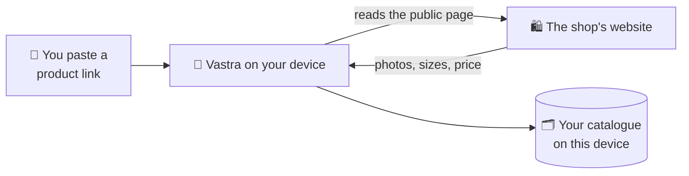

<h1 align="center">
  <br>
  <a href="https://github.com/sudharamachandranrajeev/vastra"></a>
  <br>
  Vastra
  <br>
</h1>

<h4 align="center">Keep the clothes, shoes and beauty products you like in one place, and compare them side by side.</h4>

<p align="center">
  <a href="https://github.com/sudharamachandranrajeev/vastra/releases"></a>
  
  
  <a href="https://github.com/sudharamachandranrajeev/brahma"></a>
</p>

<p align="center">
  <a href="#-what-it-does">What it does</a> •
  <a href="#-get-started">Get started</a> •
  <a href="#-how-it-works">How it works</a> •
  <a href="#-faq-and-troubleshooting">FAQ</a> •
  <a href="#%EF%B8%8F-for-developers">For developers</a>
</p>

<p align="center">
  
</p>

Vastra is a personal catalogue for fashion and personal care: clothing, footwear, accessories,
cosmetics, fragrance and body care. Paste a product link from a shop and Vastra fills in the
details. It needs no account, and everything stays on your device. Status: **early test
releases** (0.x). It does not search shops for you yet.

## ✨ What it does

- 🔗 **One link, all the details** – paste a product link from a shop on Vastra's list, and it
  reads the shop's public page: photos, name, brand, materials, sizes, colours and price. Unknown
  details stay blank.
- 🔎 **Discover** – search your finds by name, brand, category, colour or material, and filter by
  category or currency. Carry on a search at a shopping search site or marketplace.
- 🗂️ **Collections** – save finds into named edits, such as a travel wardrobe or a gift list.
- ⚖️ **Compare** – put up to four products side by side. Prices stay in their own currency.
- 🧵 **Find sellers** – a hand-picked list of independent, wholesale and high-street sources, with
  their public website and contact links.
- 🔄 **Refresh** – add the same link again to update its details. It keeps its place in your
  collections.
- 📴 **Offline, no account** – your catalogue lives on your device. Sample photos work offline.
  ...and more.

**Coming in the next release (0.3.0):**

- 📤 **Share from any shop or app** – send a link from Android's share menu, or copy it on a
  computer, and Vastra offers to add it. Links from any public shop work.
- 🏷️ **Sorted for you** – each find gets a category and type, and Vastra learns from your fixes.
  "More like this" suggests similar finds, worked out on your device.
- 📦 **Take it anywhere** – export your catalogue for online shop platforms and the common
  product-feed formats, or as schema.org JSON.
- 🛟 **Updates and backups** – Vastra checks for new versions, installs checked updates and can roll
  back. **Back up catalog** and **Restore from backup** live in **Settings**, with **Report a
  problem**.
- 📜 **A paper look** – cream paper, copper buttons and folder tabs, with optional quiet sounds.

## 📸 Screenshots

<table>
  <tr>
    <td align="center"><br><sub>Discover on a phone</sub></td>
    <td align="center"><br><sub>The web preview</sub></td>
  </tr>
</table>

<sub>The app screenshots show the sample catalogue, rendered from the current code, in the look
coming in the next release. Release 0.2.0 has the same pages in a plainer style.</sub>

## 🚀 Get started

### Step 1 – Download

Open the [releases page](https://github.com/sudharamachandranrajeev/vastra/releases) and, under
the newest release, pick the file for your device:

| Your device | File to download | Works on |
| --- | --- | --- |
| 🤖 Android phone | `Vastra-<version>-android.apk` | Android 7 and newer |
| 🪟 Windows computer | `Vastra-<version>-windows-x64-setup.exe` | Windows 10 (1809 or newer) and 11 |
| 🐧 Linux computer | `Vastra-<version>-linux-x64.tar.gz` | Ubuntu 22.04 or newer and similar (64-bit x86) |
| 🏔️ Arch or Omarchy | `vastra-bin-<version>-1-x86_64.pkg.tar.zst` | Arch Linux and Omarchy (64-bit) |

Each release also has `SHA256SUMS.txt`, a list of fingerprints to check the files are genuine.

### Step 2 – Install

<details>
<summary><b>🤖 Android</b></summary>

1. Open the downloaded `.apk` on your phone.
2. If Android asks, allow installs from your browser or file manager. This is normal for apps
   from outside an app store.
3. Tap **Install**, then **Open**.

</details>

<details>
<summary><b>🪟 Windows</b></summary>

1. Double-click `Vastra-<version>-windows-x64-setup.exe`. No admin rights needed.
2. Windows may say *"Windows protected your PC"*. This appears because the app isn't paid-signed
   yet, not because it is harmful. Click **More info → Run anyway**.
3. Follow the installer, then open **Vastra** from the Start menu.

Prefer no installer? Download `…-windows-x64-portable.zip`, unzip the whole folder and run
`vastra.exe`.

</details>

<details>
<summary><b>🐧 Linux</b></summary>

1. Open a terminal in the folder where the download landed.
2. Unpack it and run the installer as your normal user (not `sudo`):
   ```sh
   tar -xzf Vastra-*-linux-x64.tar.gz
   cd vastra-*-linux-x64 && ./install.sh
   ```
3. Open **Vastra** from your app menu.

Vastra needs GTK 3 and the system OpenGL libraries (`gtk3` and `libglvnd` on Arch). To remove it,
run `./install.sh --uninstall`. Your catalogue stays.

</details>

<details>
<summary><b>🏔️ Arch or Omarchy package</b></summary>

1. Open a terminal in the folder where the download landed.
2. Install it with pacman:
   ```sh
   sudo pacman -U ./vastra-bin-*.pkg.tar.zst
   ```
3. Open **Vastra** from your app menu.

Use either this package or the tarball installer, not both.

</details>

### Step 3 – First launch

1. Vastra opens on **Discover**, with a few sample products to show how it works. No sign-in is
   needed.
2. Tap **Add a product link** (**Add link** on a phone), paste a link from a shop, and add it.
3. Tap the ♡ heart on a product to save it into a **Collection**.
4. Tap **Compare** on up to four products to see them side by side.

## 🧭 How it works



- **Vastra reads only the page you give it**, and only the public product details on it. It does
  not sign in to shops or get around their blocks.
- **When a shop blocks reading**, Vastra still saves the link so you can refresh it later.
- **Your catalogue stays on your device.** There is no account and no sync. Desktop apps and the
  web preview keep separate catalogues.
- **Prices are the shop's listed price.** Shipping, taxes and duties are not included.

> [!IMPORTANT]
> The catalogue is not backed up automatically, and it is not encrypted. On Android, uninstalling
> Vastra deletes it. On a computer, close Vastra and copy the data folder (see FAQ) to keep a copy.

## ❓ FAQ and troubleshooting

<details>
<summary><b>A shop's link added only the name, without photos or price</b></summary>

Some shops block automatic reading or hide their product details. Vastra saves the link anyway.
Try adding the same link again later to refresh it.
</details>

<details>
<summary><b>Does Vastra search shops or find the cheapest seller for me?</b></summary>

Not yet. It searches your own catalogue and the samples. Live search across shops, exact-product
matching and delivered prices are on the [roadmap](docs/ROADMAP.md).
</details>

<details>
<summary><b>Windows says the app might be unsafe</b></summary>

The build isn't code-signed (a paid certificate). Click **More info → Run anyway**. Check the file
against `SHA256SUMS.txt` on the release if you want to be sure it is genuine.
</details>

<details>
<summary><b>Where is my catalogue stored?</b></summary>

Linux: `~/.local/share/io.github.sudharamachandranrajeev.vastra/vastra.sqlite`. Windows: Vastra's
folder under `%APPDATA%`. Android: inside the app. Uninstalling on a computer leaves it in place.
</details>

<details>
<summary><b>Are the sample products for sale?</b></summary>

No. Samples carry a "Sample" label. Their prices and details are made up for illustration.
</details>

## 🛠️ For developers

<details>
<summary>Build from source, test and release</summary>

You need [Git](https://git-scm.com) and [Flutter](https://flutter.dev) 3.47.7. Linux builds also
need Clang, CMake, Ninja, pkg-config, GTK 3 development files and liblzma.

```bash
git clone https://github.com/sudharamachandranrajeev/vastra
cd vastra/native
flutter pub get --enforce-lockfile
flutter run -d linux        # or windows, or an Android device

flutter analyze && flutter test --concurrency=2 --timeout 60s   # check and test
VASTRA_SHOTS=/tmp/vastra-shots flutter test test/screenshots_test.dart   # render the screenshots
```

- The Flutter app is in `native/`. The web preview (React on Cloudflare Workers) is at the
  repository root.
- Release signing, data locations, installers, the updater and packaging:
  [native development and packaging](docs/NATIVE.md). Web app: [web development](docs/WEB.md).
- A `v*` tag builds, smoke-tests and publishes every package (`.github/workflows/release.yml`).
  Plans: [roadmap](docs/ROADMAP.md). Changes per version: [CHANGELOG.md](CHANGELOG.md).

</details>

<details>
<summary>Credits</summary>

- [Flutter](https://flutter.dev), [Dart](https://dart.dev), [SQLite](https://sqlite.org),
  [sqlite3](https://pub.dev/packages/sqlite3), [http](https://pub.dev/packages/http),
  [html](https://pub.dev/packages/html), [path_provider](https://pub.dev/packages/path_provider),
  [url_launcher](https://pub.dev/packages/url_launcher), [intl](https://pub.dev/packages/intl) and
  [uuid](https://pub.dev/packages/uuid)
- [React](https://react.dev), [Vinext](https://github.com/cloudflare/vinext),
  [Drizzle](https://orm.drizzle.team) and [Lucide](https://lucide.dev) for the web preview
- [Inter](https://rsms.me/inter/) and [Lora](https://github.com/cyrealtype/Lora-Cyrillic) fonts,
  under the SIL Open Font License (texts beside the fonts in `native/assets/fonts/`)
- Sample photos are openly licensed stock photos. Source links are in
  `native/assets/data/products.json`; no brand or seller endorsement is implied.

</details>

## Related

Vastra runs on its own, and the [Brahma](https://github.com/sudharamachandranrajeev/brahma) app
links to it from its home screen. The Brahma family:

| App | What it does |
| --- | --- |
| [brahma](https://github.com/sudharamachandranrajeev/brahma) | The shared core and the all-in-one app |
| [artha](https://github.com/sudharamachandranrajeev/artha) | Money: accounts, spending, bills and investments |
| [graha-anveshana](https://github.com/sudharamachandranrajeev/graha-anveshana) | Find a home to rent or buy |
| [vahana-anveshana](https://github.com/sudharamachandranrajeev/vahana-anveshana) | Find a car |
| [udyoga](https://github.com/sudharamachandranrajeev/udyoga) | Career and job hunting |
| [vidya](https://github.com/sudharamachandranrajeev/vidya) | Learning, flashcards and focus |
| [bhojana](https://github.com/sudharamachandranrajeev/bhojana) | Shopping lists priced across UK shops |

## License

No licence has been chosen yet; all rights reserved. Bundled third-party parts keep their own
licences and notices.

---

> GitHub [@sudharamachandranrajeev](https://github.com/sudharamachandranrajeev)
