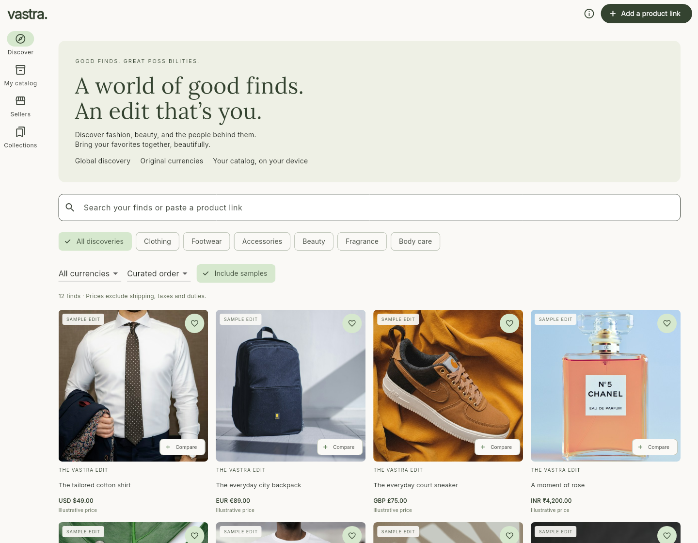
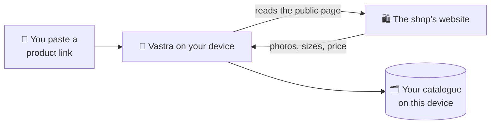

<h1 align="center">
  <br>
  <a href="https://github.com/sudharamachandranrajeev/vastra"></a>
  <br>
  Vastra
  <br>
</h1>

<h4 align="center">Keep the clothes, shoes and beauty products you like in one place, and compare them side by side.</h4>

<p align="center">
  <a href="https://github.com/sudharamachandranrajeev/vastra/releases"></a>
  
  
  <a href="https://github.com/sudharamachandranrajeev/brahma"></a>
</p>

<p align="center">
  <a href="#-what-it-does">What it does</a> •
  <a href="#-get-started">Get started</a> •
  <a href="#-how-it-works">How it works</a> •
  <a href="#-faq-and-troubleshooting">FAQ</a> •
  <a href="#%EF%B8%8F-for-developers">For developers</a>
</p>

<p align="center">
  
</p>

Vastra is a personal catalogue for fashion and personal care: clothing, footwear, accessories,
cosmetics, fragrance and body care. Paste a product link from a shop and Vastra fills in the
details. It needs no account, and everything stays on your device. Status: **early test
releases** (0.x). It does not search shops for you yet.

## ✨ What it does

- 🔗 **One link, all the details** – share a product link from any shop or app, or copy it on a
  computer, and Vastra reads the shop's public page: photos, name, brand, materials, sizes,
  colours, price and stock. Unknown details stay blank.
- 📉 **Watch prices and stock** – choose an item, and a size or colour if you like. Vastra tells you
  when the price drops or it comes back in stock: once a day in one short summary, or straight
  away for things that sell out fast. Each find keeps its price history, and old prices are marked.
- 📏 **Your size, per brand** – note the size you bought, whether you kept it and how it fit. Next
  time you look at that brand, Vastra shows the size your own history points to, and why. Store
  size charts are saved with the item.
- 👗 **Your wardrobe** – mark what you own and what you paid, log what you wear, and see cost per
  wear, most worn and never worn. Build outfits and moodboards from items you own or only want, plan
  them on a calendar (with an optional morning reminder), and make packing lists. No item limit, no
  ads, no account.
- 🎁 **Share a wish list, no account** – save a collection as one web page that anyone can open in a
  browser. Gift givers tap "I'll buy this" and send a short code to each other, so nobody buys the
  same gift twice and the list's owner never sees who chose what. Lock a collection as private and it
  is left out of every export and shared list.
- 🔐 **Encrypted backup and your own sync** – back up everything to a file locked with a passphrase
  you choose. To use several devices, point Vastra at a WebDAV folder you run (Nextcloud, a NAS). It
  keeps one encrypted file there, so the server never sees your catalog. Syncing only adds, and never
  deletes or overwrites.
- 🔎 **Discover** – search your finds by name, brand, category, colour or material, and filter by
  category or currency. "More like this" suggests similar finds, worked out on your device.
- 🛍️ **Shop in Vastra** – search Amazon, eBay and other shops in Vastra's own browser, and sign in
  to see your own prices. On a product page, tap **Save to Vastra** and it reads what the page shows.
  Or pick a screenshot of something you saw, and Vastra reads its words and price to search for it.
- 📷 **Search by photo** – pick a photo and Vastra finds the items with the closest colours and
  pattern. When a shop leaves out the colour, material or pattern, Vastra suggests them and you
  decide. All of it happens on your device, with no AI service and no photo sent anywhere.
- 📝 **Your notes and corrections** – add a note to any find, with sizes, codes or links. Fix a
  name, colour or size the shop got wrong; your version survives every refresh and the shop's value
  is one tap away. Out-of-date prices are marked, and one tap checks them all again.
- 📤 **Your data is yours** – export the whole catalog as a spreadsheet, notes included, for free.
  Move or remove many finds at once, or erase everything on the device.
- 🏷️ **Sorted for you** – each find gets a category and type, and Vastra learns from your fixes.
- 🗂️ **Collections** – save finds into named edits, such as a travel wardrobe or a gift list.
- ⚖️ **Compare** – put up to four products side by side. Prices stay in their own currency.
- 🧵 **Find sellers** – a hand-picked list of independent, wholesale and high-street sources, with
  their public website and contact links.
- 📦 **Take it anywhere** – export your catalogue for online shop platforms and the common
  product-feed formats, or as schema.org JSON.
- 🛟 **Updates and backups** – Vastra checks for new versions, installs checked updates and can roll
  back. **Back up catalog** and **Restore from backup** live in **Settings**.
- 📴 **Offline, no account** – your catalogue lives on your device. No ads, and no notifications
  except the alerts you set.

## 🧭 How it works



- **Vastra reads only the page you give it**, and only the product details on it. When you browse
  in Vastra's browser, you sign in to shops yourself and Vastra reads only the page you save. It
  does not get around shops' blocks.
- **When a shop blocks reading**, Vastra still saves the link so you can refresh it later.
- **Your catalogue stays on your device.** There is no Vastra account. Sync goes only to a server
  you run, if you set one up. Desktop apps and the web preview keep separate catalogues.
- **Prices are the shop's listed price.** Shipping, taxes and duties are not included.

> [!IMPORTANT]
> The catalogue is not backed up automatically, and it is not encrypted. On Android, uninstalling
> Vastra deletes it. On a computer, close Vastra and copy the data folder (see FAQ) to keep a copy.

## ❓ FAQ and troubleshooting

<details>
<summary><b>A shop's link added only the name, without photos or price</b></summary>

Some shops block automatic reading or hide their product details. Vastra saves the link anyway.
Try adding the same link again later to refresh it.
</details>

<details>
<summary><b>How good is Search by photo?</b></summary>

It compares colour and how plain or busy the pattern is. It does not see shape, so a red scarf and a
red dress can match. Photos with a busy background or a model match less well. It runs on your
device, so nothing is sent to an AI service. To try it:

1. On **Discover**, choose **Search by photo** and pick a photo.
2. Wait while Vastra reads the catalog photos (only the first time for each item).
3. Tap a match to open it. Open any item and choose **Find this look** to search from its photo.
</details>

<details>
<summary><b>Where do suggested colours and materials come from?</b></summary>

From the item's own name, description and link, and, if you choose **Suggest from the photo**, from
its main photo. Each suggestion says which. Nothing changes until you choose **Use it** or **Edit**.
**Not right** hides a suggestion for good. A detail you chose shows "(you chose)" and can be cleared.
</details>

<details>
<summary><b>How do price and stock alerts work?</b></summary>

1. Open a find and turn on **Watch this item**.
2. Pick a size or colour if it matters, and what to hear about: **Price drops** (any drop, a
   percentage, or a price you set) and **Back in stock**.
3. In **Settings**, turn on **Check watched items automatically**. On Android, Vastra checks in the
   background. On a computer, it checks while Vastra is open. **Check watched items now** works
   any time.

Vastra only alerts after a check that just succeeded, and each alert shows the old and new price,
the shop and when it checked. If a shop blocks a check, you get a "may be out of date" note, not an
alert. One switch in **Settings** turns every alert off.
</details>

<details>
<summary><b>How do outfits, the planner and cost per wear work?</b></summary>

1. Open a find and turn on **I own this**. Add the price you paid if you want cost per wear.
2. Tap **Wore it today** on an item, or on an outfit. Cost per wear is the price divided by the days
   you wore it, and shows after the first wear.
3. In the **Wardrobe** tab, make an outfit or moodboard, plan it on a day, and tap the bell for a
   reminder that morning. Turn on **Outfit reminders** in **Settings** to receive them.
4. **Packing** lists can start from the outfits you planned between two dates.

Everything stays on your device and is included in backups. Exports of your finds leave it out.
</details>

<details>
<summary><b>How do I share a wish list?</b></summary>

1. Put the items in a collection, then tap the export icon and choose **Wish list page**.
2. Pick the collection, decide whether to show prices, add a message if you like, and save the file.
   Send it by email or chat. It opens in any browser, with no account and nothing to install.
3. A gift giver taps **I'll buy this** on what they will get. The page gives them a short code. They
   send it to the other gift givers, who paste it into **Codes from others** to see what is taken.
   Send the codes to each other, not to the owner, to keep the surprise.
4. **Wish list file** makes a small file that another Vastra opens with **Open a shared list** in
   the Collections tab.

The page never shows what you paid, what you wore or your sizes. Tick **Private** on a collection
to keep it out of exports and shared lists altogether.
</details>

<details>
<summary><b>How do backup and sync work?</b></summary>

1. **Backup:** in **Settings**, tap **Back up catalog** and choose a passphrase (at least 8 characters).
   Vastra saves a `.vstrbk` file that cannot be read without it. **Restore from backup** asks for the
   passphrase again. Vastra cannot recover a lost passphrase.
2. **Sync:** tap **Sync with my server** and enter the address of a WebDAV folder, your user name and
   password, and a passphrase. Use the same passphrase on every device. Vastra encrypts the catalog
   on your device, uploads one file, and on the next device merges it in.
3. The password and passphrase are kept only until you close Vastra. The address and user name are
   remembered.

Restoring and syncing only add: finds, price history, wear days, outfits and lists you do not have
yet. They never delete or overwrite, so a removal on one device does not remove it on another. Plain
`http://` addresses are accepted only on your own network.
</details>

<details>
<summary><b>How do I shop and save from Amazon, eBay or any shop?</b></summary>

1. On **Discover**, choose **Shop in Vastra**.
2. Type what you are looking for and choose a shop, or type a shop's address such as `zara.com`.
   Pick your Amazon and eBay country from the lists.
3. Sign in if you want your own prices. The sign-in goes to the shop, not to Vastra.
4. Open a product and tap **Save to Vastra**. If it picks the wrong name, select the product's name
   on the page and tap it again.

On Windows and Linux the shop opens in its own window, with the button in the bottom-right corner.
Some sign-ins, such as **Sign in with Google**, refuse to work inside apps. Use the shop's own email
sign-in instead. Some shops show an error page or a check in Vastra's browser. Vastra does not get
around these. Copy the link from your usual browser and paste it into Vastra instead. To forget
every shop sign-in, choose **Settings → Sign out of shops**.
</details>

<details>
<summary><b>How do I fix a detail the shop got wrong, or add a note?</b></summary>

1. Open the find.
2. Under **Your notes**, type anything you want to remember, then tap **Save note**. Links in the
   note become buttons.
3. Under **Correct the details**, tap the pencil next to a detail, type the right value and tap
   **Save**.

Your note and corrections stay when the find is refreshed. A corrected detail says what the shop
lists now; tap the undo arrow to use the shop's value again. Prices and stock always come from the
shop.
</details>

<details>
<summary><b>How do I keep prices current?</b></summary>

A find whose price was last checked more than 7 days ago, or whose shop blocked the last check, shows
**Out of date** on its card. In **My catalog**, tick **Needs a check** to see only those, and tap
**Check now** to fetch them again. Your notes and corrections are kept.
</details>

<details>
<summary><b>How do I take my data out, or delete it?</b></summary>

- **Export:** tap the share icon at the top, choose **Spreadsheet (CSV)** and save. You get every
  find with its collection, your notes and the date its price was last checked.
- **Move or remove many finds:** in **My catalog** or **Collections**, tap **Select**, tick the
  finds, then **Move to…** or **Remove**.
- **Erase everything:** **Settings → Erase everything**, then type ERASE. This deletes everything on
  this device. Back up first if you might want it again. Backup files and your sync folder are not
  touched.
</details>

<details>
<summary><b>How does reading a screenshot work?</b></summary>

1. On **Discover**, choose **Shop in Vastra**, then **From a screenshot**, and pick the image.
2. Vastra reads the text on your device and leaves out app clutter such as likes and buttons.
3. Tap the words to add or remove them from the search, then choose a shop. Links in the screenshot
   can be opened directly.

Android reads text with an on-device recognizer that comes with the app. On Windows and Linux,
install [Tesseract](https://github.com/tesseract-ocr/tesseract) and its English data first (Arch:
`sudo pacman -S tesseract tesseract-data-eng`; Windows: the
[UB Mannheim installer](https://github.com/UB-Mannheim/tesseract/wiki)). The image is never sent
anywhere.
</details>

<details>
<summary><b>Does Vastra find the cheapest seller for me?</b></summary>

Not yet. **Shop in Vastra** opens shop searches and **Find similar elsewhere** searches for an item,
but you compare the results yourself. Exact-product matching and delivered prices are on the
[roadmap](docs/ROADMAP.md).
</details>

<details>
<summary><b>Windows says the app might be unsafe</b></summary>

The build isn't code-signed (a paid certificate). Click **More info → Run anyway**. Check the file
against `SHA256SUMS.txt` on the release if you want to be sure it is genuine.
</details>

<details>
<summary><b>Where is my catalogue stored?</b></summary>

Linux: `~/.local/share/io.github.sudharamachandranrajeev.vastra/vastra.sqlite`. Windows: Vastra's
folder under `%APPDATA%`. Android: inside the app. Uninstalling on a computer leaves it in place.
</details>

<details>
<summary><b>Are the sample products for sale?</b></summary>

No. Samples carry a "Sample" label. Their prices and details are made up for illustration.
</details>

## 🛠️ For developers

<details>
<summary>Build from source, test and release</summary>

You need [Git](https://git-scm.com) and [Flutter](https://flutter.dev) 3.47.7. Linux builds also
need Clang, CMake, Ninja, pkg-config, GTK 3, GStreamer and WebKitGTK 4.1 development files,
and liblzma.

```bash
git clone https://github.com/sudharamachandranrajeev/vastra
cd vastra/native
flutter pub get --enforce-lockfile
flutter run -d linux        # or windows, or an Android device

flutter analyze && flutter test --concurrency=2 --timeout 60s   # check and test
VASTRA_SHOTS=/tmp/vastra-shots flutter test test/screenshots_test.dart   # render the screenshots
```

- The Flutter app is in `native/`. The web preview (React on Cloudflare Workers) is at the
  repository root.
- Release signing, data locations, installers, the updater and packaging:
  [native development and packaging](docs/NATIVE.md). Web app: [web development](docs/WEB.md).
- A `v*` tag builds, smoke-tests and publishes every package (`.github/workflows/release.yml`).
  Plans: [roadmap](docs/ROADMAP.md). Changes per version: [CHANGELOG.md](CHANGELOG.md).

</details>

<details>
<summary>Credits</summary>

- [Flutter](https://flutter.dev), [Dart](https://dart.dev), [SQLite](https://sqlite.org),
  [sqlite3](https://pub.dev/packages/sqlite3), [http](https://pub.dev/packages/http),
  [html](https://pub.dev/packages/html), [path_provider](https://pub.dev/packages/path_provider),
  [url_launcher](https://pub.dev/packages/url_launcher), [intl](https://pub.dev/packages/intl) and
  [uuid](https://pub.dev/packages/uuid)
- [React](https://react.dev), [Vinext](https://github.com/cloudflare/vinext),
  [Drizzle](https://orm.drizzle.team) and [Lucide](https://lucide.dev) for the web preview
- [Inter](https://rsms.me/inter/) and [Lora](https://github.com/cyrealtype/Lora-Cyrillic) fonts,
  under the SIL Open Font License (texts beside the fonts in `native/assets/fonts/`)
- Sample photos are openly licensed stock photos. Source links are in
  `native/assets/data/products.json`; no brand or seller endorsement is implied.

</details>

## Related

Vastra runs on its own, and the [Brahma](https://github.com/sudharamachandranrajeev/brahma) app
links to it from its home screen. The Brahma family:

| App | What it does |
| --- | --- |
| [brahma](https://github.com/sudharamachandranrajeev/brahma) | The shared core and the all-in-one app |
| [artha](https://github.com/sudharamachandranrajeev/artha) | Money: accounts, spending, bills and investments |
| [graha-anveshana](https://github.com/sudharamachandranrajeev/graha-anveshana) | Find a home to rent or buy |
| [vahana-anveshana](https://github.com/sudharamachandranrajeev/vahana-anveshana) | Find a car |
| [udyoga](https://github.com/sudharamachandranrajeev/udyoga) | Career and job hunting |
| [vidya](https://github.com/sudharamachandranrajeev/vidya) | Learning, flashcards and focus |
| [bhojana](https://github.com/sudharamachandranrajeev/bhojana) | Shopping lists priced across UK shops |

## License

No licence has been chosen yet; all rights reserved. Bundled third-party parts keep their own
licences and notices.

---

> GitHub [@sudharamachandranrajeev](https://github.com/sudharamachandranrajeev)
